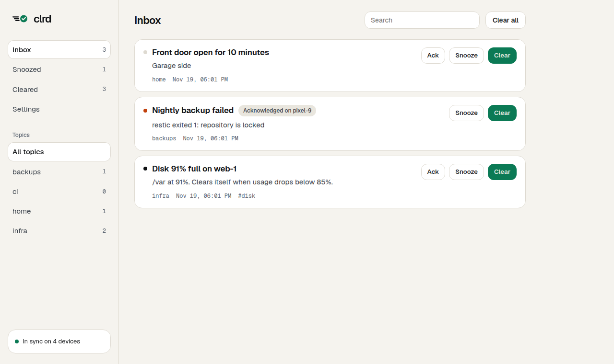
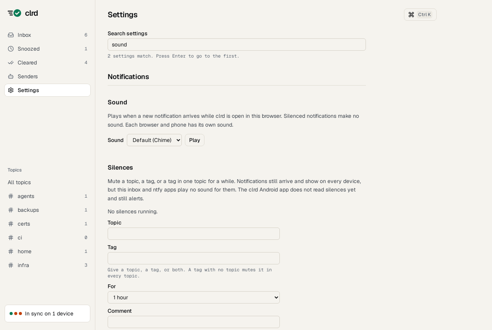

<p align="center">
  
</p>

<h1 align="center">clrd</h1>

<p align="center"><strong>Self-hosted push notifications. Dismiss once, gone everywhere.</strong></p>

Send an alert with one HTTP call. It shows up on your Android phone, your tablet
and the web inbox. Clear it on any one of them (in the phone app, or Clear on
the web) and it clears on all the others. Swiping a phone notification away
only hides it on that phone, unless you turn on "Swipe clears everywhere". When the problem fixes itself, the sender resolves it and it clears
everywhere without anyone touching it.

Getting started needs one setting: start it with `CLRD_BASE_URL` set to the
HTTPS address your proxy serves it on, open the setup link it prints to make
your admin token, scan the Link a phone code with the app and approve it, and
send. Everything else (check-ins, webhooks, icons, snooze times, display
settings) is optional and has a default. Server settings, topics, tokens and
webhooks are all on the REST API (`/openapi.json` describes it), so a script or
an AI agent can set them up without a person clicking through Settings.

Small on purpose. The server is one 16.3 MB binary (measured 2026-11-23;
ntfy 2.38.1: 77.5 MB) and the Android app is a 1.9 MB APK (measured
2026-11-20; ntfy 1.25.2: 9.3 MB). CI fails any change that grows either past its budget in
[`.github/size-budget`](.github/size-budget).

<p align="center">
  
  
</p>
<p align="center">
  
</p>

The pictures are made by `web/e2e/screens.mjs` with `SET=readme` against the
real server and fixed demo data, so they show the inbox as it is on `main`.

> **Status: early, no tagged release yet.** The server, web inbox, Android app
> and SDKs have tests that run in CI, and so do the integration guides (see the
> [integrations table](docs/integrations/README.md) for what each one runs). The Android app
> is not in the main F-Droid catalog yet; every Android change on `main` goes to clrd's own
> F-Droid repo ([how to add it](android/README.md#install-from-the-clrd-f-droid-repo)).
> See [CHANGELOG.md](CHANGELOG.md).

## Why clrd

clrd publishes and subscribes the [ntfy](https://github.com/binwiederhier/ntfy)
way. The difference: in ntfy, when you clear a notification on one
device, your other devices keep it. clrd keeps every notification's state on
the server, so a clear anywhere clears it everywhere, and a phone that was
offline catches up the moment it reconnects.

## Features

- **One binary, one SQLite file.** No Redis, no broker. Or one Docker container.
  Runs at its own domain or under a sub-path behind your proxy.
- **State that syncs.** Dismiss (hide it), acknowledge (someone is on it),
  resolve (it is fixed) and snooze, each shown on every device. Snooze times
  and the default are one setting shared by every device.
- **Marks.** You (in the web inbox), another person or an agent with its own token can mark a card
  seen, or actioned with a note and link ("stew actioned: filed relay#512").
  It clears nothing; everyone on the topic sees who handled it.
- **Self-resolving alerts.** Senders tag an alert with their own ID and resolve
  it by that ID when the fault clears. Or give one `"expires": "30m"` and it
  clears itself then.
- **Senders.** Every service, app or person that sends shows up on its own, with
  nothing to set up: an admin sees who sent what, where and when, in the web
  inbox, in the Android app's Settings or at `GET /api/v1/senders`. Pause, mute,
  cap the priority or reroute one sender from its web page or the app, and undo any change.
  Its web page can also raise an urgent alarm when that sender goes quiet too long.
  Add a service on the Senders page makes a one-topic token and the URL to paste.
- **Missed check-in alerts.** Give a topic an interval, say 25 hours, and clrd
  raises an urgent alert when a backup or cron job stops reporting in.
- **Repeat and silence.** Send with `"repeat": "5m"` and the alert rings
  again on the phone and in the web inbox until someone acts on it, 10 more
  times by default ([docs/repeat.md](docs/repeat.md)).
  A silence mutes a topic or tag until a set time
  ([docs/silences.md](docs/silences.md)).
- **ntfy compatible.** Publish and subscribe the ntfy way (JSON, SSE,
  WebSocket, Basic auth), so most ntfy scripts and the ntfy app work unchanged.
- **Gotify senders work.** `POST /message` with an app token, as Gotify
  takes it, so Apprise, the gotify CLI, Watchtower and curl scripts keep
  sending. See
  [Gotify senders](docs/integrations/gotify.md).
  `clrd import gotify` brings over a Gotify server's apps, their tokens and
  message history ([Switch from Gotify](docs/migrate-from-gotify.md)).
- **Pushover scripts work.** `POST /1/messages.json` with a clrd app key, as
  Pushover takes it, for curl scripts and senders whose Pushover URL can be
  changed. See [Pushover senders](docs/integrations/pushover.md).
- **Imports an ntfy server.** `clrd import ntfy` brings over users, passwords,
  tokens, per-topic access rules, message history and attachments, so you can
  swap the hostname and keep every credential. See
  [Switch from ntfy](docs/migrate-from-ntfy.md).
  Email is not supported.
- **Files and icons.** Agents and scripts can attach a file or an icon to a
  notification, and each topic can have its own icon. The server stores
  uploaded files; icons are image links. The Android app and the web inbox
  show both.
- **Web inbox built in.** [Install it as an app](docs/web-app.md) on your phone
  or computer. Server-rendered, live over WebSocket, the main actions
  work without JavaScript, Markdown formatting and links, link previews,
  Share and Copy on each card, a part swipe on a phone that shows a card's buttons, optional stacking by topic, a Ctrl+K command
  palette, a Send box for a quick note to your phone, a sound for new
  notifications (pick one in Settings, silenced ones stay quiet), system
  notifications through Web Push even with the tab closed (off until you
  turn them on in Settings; needs HTTPS), silences
  started and ended from Settings, subscribe and unsubscribe per topic (from
  a card or Settings, every device you sign in to follows), a dot for each linked device (up to six)
  showing which are connected, a Light, Dark or System theme, phone width. Settings sit in six
  sections with a search box that also finds a setting by keywords such as
  "do not disturb", and an About section shows the running version and
  what changed in each version, with a dismissible What's new note after an update.
- **Android app.** Kotlin, no Google Play Services, so it runs on GrapheneOS
  and LineageOS. Reply and link buttons in the tray, notifications stacked by
  topic if you turn it on (off by default), Share and Copy, Markdown formatting and tappable links, a Send
  button for a quick note to your other devices. A choice of
  six built-in notification sounds (or the phone's default, or none), kept
  on the server so an agent can set it. Trusts
  certificate authorities you install, for a server on a home-lab CA.
- **Add devices by QR code.** Sign a new browser in by scanning its code with
  the app, or link a phone from Settings in a signed-in browser. Both screens
  show the same 4-digit number, so no token is typed or copied.
- **Add an agent in one step.** Press Add agent in Settings, give it a name
  and its topics, and hand it the one-use invite. The agent gets its own user
  and token held to those topics, cannot approve its own prompts, and shows in
  Linked devices where you can unlink it. See
  [docs/integrations/agent-invite.md](docs/integrations/agent-invite.md).
- **For tools and agents.** Python, JavaScript and Go SDKs, a GitHub Action,
  and an MCP server so an AI agent can notify you and wait for your answer.
  Claude Code and Codex can ask your phone before running a command, and
  each device has its own approve setting (allowed, ask or denied), so an
  agent's token cannot approve its own prompts. A
  [Claude Code plugin](docs/integrations/claude-code.md) sets that up with
  pings when a task finishes, in one install.
  A format check finds senders whose messages are hard to read and hands an
  agent a ready prompt to fix them.

## Quick start

```sh
git clone https://github.com/thejdubb02/clrd && cd clrd
# set CLRD_BASE_URL in docker-compose.yml to your public https URL
docker compose up -d
docker compose logs clrd    # prints a one-time setup link for your admin token
```

It listens on `127.0.0.1:8080`; put HTTPS in front as in
[docs/self-host.md](docs/self-host.md). Then make a token for sending and send
something:

```sh
export CLRD_TOKEN=$(docker compose exec -T clrd clrd token create --name script --scope publish)
curl -H "Authorization: Bearer $CLRD_TOKEN" \
  -d '{"topic":"infra","title":"Disk full","message":"web-1 at 95%","priority":4,"external_id":"disk-web-1"}' \
  https://clrd.example.com/api/v1/notifications

# ntfy style also works
curl -u ":$CLRD_TOKEN" -d "Disk full" https://clrd.example.com/infra
```

Tokens, backups and the binary install: [docs/self-host.md](docs/self-host.md).

## Integrations

curl, the [SDKs](sdk/), GitHub Actions, MCP (Claude Code, Claude Desktop,
Cursor, VS Code, Windsurf, Zed, Codex CLI, Gemini CLI), Home Assistant, Gatus, Uptime Kuma, Alertmanager, Grafana, Apprise,
ntfy clients, Gotify senders and Watchtower. Built-in webhook templates for GitHub, Sentry,
Stripe, Jira, Healthchecks.io, Proxmox VE, Zabbix, Netdata, Jellyfin and the
*arr apps, with signature checks, and your own template for any other
service's JSON, which you can try on a sample payload before going live.
Outgoing webhooks tell your own service when someone
dismisses, acks, resolves, snoozes or replies. Setup for each, and which ones resolve themselves:
[docs/integrations](docs/integrations/README.md).

## Docs

- [Install the web inbox](docs/web-app.md)
- [docs/self-host.md](docs/self-host.md): run it, put HTTPS in front, tokens, backups
- [docs/integrations/mcp.md](docs/integrations/mcp.md): MCP tools for agents, and phone approval of agent prompts
- [docs/formatting.md](docs/formatting.md): Markdown, emoji, display settings and the format check
- [docs/repeat.md](docs/repeat.md): alerts that ring again until someone acts, 10 more times by default
- [docs/silences.md](docs/silences.md): mute a topic or tag until a set time
- [docs/migrate-from-ntfy.md](docs/migrate-from-ntfy.md): switch from ntfy
- [docs/migrate-from-gotify.md](docs/migrate-from-gotify.md): switch from Gotify
- [docs/integrations/README.md](docs/integrations/README.md): every integration guide and what its test runs
- [docs/SPEC.md](docs/SPEC.md): the API, sync model, states and auth
- [android/README.md](android/README.md): build the Android app
- [web/README.md](web/README.md): how the web pages are served

## Repo layout

| Path | What |
|---|---|
| `server/` | Go server: API, sync, ntfy compatibility, MCP |
| `web/` | Landing page, docs pages and the inbox, embedded in the binary |
| `android/` | Android app (Kotlin, Jetpack Compose) |
| `sdk/` | Python, JavaScript and Go clients, GitHub Action |
| `docs/` | Self-hosting, spec and integration guides, also served at `/docs` |
| `assets/` | Logo, icon and fonts |

## Contributing

Bug reports, ideas and pull requests are welcome. Start with
[CONTRIBUTING.md](CONTRIBUTING.md). Security problems go through
[SECURITY.md](SECURITY.md), not a public issue.

## License

[Apache-2.0](LICENSE). Geist and Geist Mono fonts are under the
[SIL Open Font License](assets/fonts/OFL.txt).
