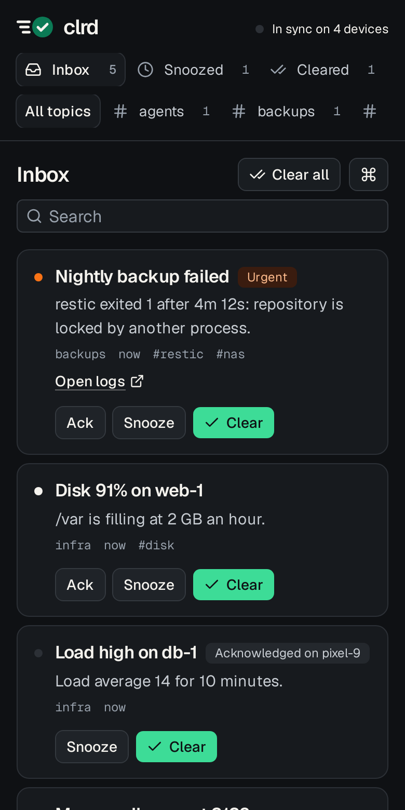

<p align="center">
  
</p>

<h1 align="center">clrd</h1>

<p align="center"><strong>Self-hosted push notifications. Dismiss once, gone everywhere.</strong></p>

<p align="center">
  <a href="https://github.com/thejdubb02/clrd/actions/workflows/go.yml"></a>
  <a href="https://github.com/thejdubb02/clrd/actions/workflows/android.yml"></a>
  <a href="https://github.com/thejdubb02/clrd/actions/workflows/sdk.yml"></a>
  <a href="LICENSE"></a>
</p>

Send an alert with one HTTP call. It shows up on your Android phone, your tablet
and the web inbox. Clear it on any one of them (swipe on a phone, Clear on the
web) and it clears on all the others. When the problem fixes itself, the sender resolves it and it clears
everywhere without anyone touching it.

<p align="center">
  
  
</p>

> **Status: early, no tagged release yet.** The server, web inbox, Android app
> and SDKs have tests that run in CI, and so do the integration guides (see the
> [integrations table](docs/integrations/README.md) for what each one runs). The Android app builds from source
> until the F-Droid listing lands. See [CHANGELOG.md](CHANGELOG.md).

## Why clrd

[ntfy](https://github.com/binwiederhier/ntfy) is great, and clrd speaks its
protocol. The gap it fills: in ntfy, when you swipe a notification away on one
device, your other devices keep it. clrd keeps every notification's state on
the server, so a dismissal anywhere clears it everywhere, and a phone that was
offline catches up the moment it reconnects.

## Features

- **One binary, one SQLite file.** No Redis, no broker. Or one Docker container.
- **State that syncs.** Dismiss (hide it), acknowledge (someone is on it),
  resolve (it is fixed) and snooze, each shown on every device.
- **Self-resolving alerts.** Senders tag an alert with their own ID and resolve
  it by that ID when the fault clears. Or give one `"expires": "30m"` and it
  clears itself then.
- **Missed check-in alerts.** Give a topic an interval, say 25 hours, and clrd
  raises an urgent alert when a backup or cron job stops reporting in.
- **ntfy compatible.** Publish and subscribe the ntfy way (JSON, SSE,
  WebSocket, Basic auth), so most ntfy scripts and the ntfy app work unchanged.
- **Imports an ntfy server.** `clrd import ntfy` brings over users, passwords,
  tokens, per-topic access rules, message history and attachments, so you can
  swap the hostname and keep every credential. See
  [Switch from ntfy](docs/migrate-from-ntfy.md).
  Email is not supported.
- **Files and icons.** Agents and scripts can attach a file or an icon to a
  notification. The server stores and serves them and the Android app shows
  them; the web inbox does not show them yet.
- **Web inbox built in.** Server-rendered, live over WebSocket, the main actions
  work without JavaScript, a Ctrl+K command palette, dark mode, phone width.
- **Android app.** Kotlin, no Google Play Services, so it runs on GrapheneOS
  and LineageOS. Reply and link buttons in the tray, Share and Copy on each
  notification, Markdown formatting and tappable links.
- **For tools and agents.** Python, JavaScript and Go SDKs, a GitHub Action,
  and an MCP server so an AI agent can notify you and wait for your answer.

## Quick start

```sh
git clone https://github.com/thejdubb02/clrd && cd clrd
# set CLRD_BASE_URL in docker-compose.yml to your public https URL
docker compose up -d
docker compose logs clrd    # prints a one-time setup link for your admin token
```

It listens on `127.0.0.1:8080`; put HTTPS in front as in
[docs/self-host.md](docs/self-host.md). Then make a token for sending and send
something:

```sh
export CLRD_TOKEN=$(docker compose exec -T clrd clrd token create --name script --scope publish)
curl -H "Authorization: Bearer $CLRD_TOKEN" \
  -d '{"topic":"infra","title":"Disk full","message":"web-1 at 95%","priority":4,"external_id":"disk-web-1"}' \
  https://clrd.example.com/api/v1/notifications

# ntfy style also works
curl -u ":$CLRD_TOKEN" -d "Disk full" https://clrd.example.com/infra
```

Tokens, backups and the binary install: [docs/self-host.md](docs/self-host.md).

## Integrations

curl, the [SDKs](sdk/), GitHub Actions, MCP (Claude Code, Claude Desktop,
Cursor), Home Assistant, Gatus, Uptime Kuma, Alertmanager, Grafana, Apprise,
ntfy clients and Watchtower. Built-in webhook templates for GitHub, Sentry,
Stripe, Jira, Healthchecks.io, Proxmox VE, Zabbix, Netdata, Jellyfin and the
*arr apps, with signature checks, and your own template for any other
service's JSON. Setup for each, and which ones resolve themselves:
[docs/integrations](docs/integrations/README.md).

## Docs

- [docs/self-host.md](docs/self-host.md): run it, put HTTPS in front, tokens, backups
- [docs/SPEC.md](docs/SPEC.md): the API, sync model, states and auth
- [android/README.md](android/README.md): build the Android app
- [web/README.md](web/README.md): how the web pages are served

## Repo layout

| Path | What |
|---|---|
| `server/` | Go server: API, sync, ntfy compatibility, MCP |
| `web/` | Landing page, docs pages and the inbox, embedded in the binary |
| `android/` | Android app (Kotlin, Jetpack Compose) |
| `sdk/` | Python, JavaScript and Go clients, GitHub Action |
| `docs/` | Self-hosting, spec and integration guides, also served at `/docs` |
| `assets/` | Logo, icon and fonts |

## Contributing

Bug reports, ideas and pull requests are welcome. Start with
[CONTRIBUTING.md](CONTRIBUTING.md). Security problems go through
[SECURITY.md](SECURITY.md), not a public issue.

## License

[Apache-2.0](LICENSE). Geist and Geist Mono fonts are under the
[SIL Open Font License](assets/fonts/OFL.txt).
